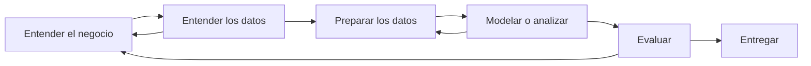

# Clase 1: teoría

🎙️ = salió de la clase · ➕ = complemento para entender mejor

## 1. Qué es el análisis de datos

➕ Analizar datos es convertir registros en respuestas que ayuden a decidir. Las preguntas suelen subir de dificultad en cuatro niveles:

| Nivel | Pregunta | Ejemplo en una tienda |
| --- | --- | --- |
| Descriptivo | ¿Qué pasó? | Se vendieron 140 limonadas |
| Diagnóstico | ¿Por qué pasó? | Se vendieron más en los días calurosos |
| Predictivo | ¿Qué va a pasar? | El sábado se venderán unas 30 |
| Prescriptivo | ¿Qué conviene hacer? | Preparar más limonada para el sábado |

## 2. El para qué del proyecto

🎙️ El proyecto se evalúa sobre todo por su **utilidad**. Puede ser muy sencillo, pero debe resolver algo real. Antes de pensar en herramientas, hay que responder para qué se hace.

➕ Esta frase ayuda a comprobarlo:

> Quiero ayudar a **[quién]** a decidir **[qué decisión]**, usando **[qué datos]**, para lograr **[qué resultado medible]**.

| Mal planteado | Bien planteado |
| --- | --- |
| "Voy a usar Python e IA con datos de ventas" | "Quiero ayudar al administrador a decidir cuánto comprar cada semana, con las ventas diarias, para reducir lo que se desperdicia" |

El primero describe herramientas. El segundo describe una decisión y puede medirse.

## 3. Datos reales y tamaño de la base

🎙️ Lo más importante es tener información real, y no hace falta una base enorme ni un gran motor de base de datos. Un Excel pequeño sirve si responde la pregunta. Un ejemplo de la clase: con datos de horarios de ingreso se pueden buscar estrategias para que la gente no llegue tarde.

➕ Para explicarle tu base a otra persona, prepara un **diccionario de datos**:

| Columna | Qué significa | Tipo | Ejemplo |
| --- | --- | --- | --- |
| `fecha` | Día de la venta | Fecha | 2026-03-02 |
| `producto` | Lo que se vendió | Texto | Limonada |
| `unidades` | Cantidad vendida | Número entero | 12 |

Agrega también de dónde salen los datos, qué periodo cubren, cuántas filas tienen y qué problemas conoces, como valores vacíos. Si tienen nombres, teléfonos o documentos, anonimízalos antes de compartirlos.

## 4. Las etapas de un proyecto

➕ Un marco muy usado es CRISP-DM. Sus etapas se repiten, porque lo que aprendes en una suele obligarte a volver a otra:



## 5. Correlación

🎙️ En la clase se menciona la tabla de correlación para mostrar que un tema llama más la atención cuando se ve para qué sirve que cuando solo se ve la fórmula.

### La idea

➕ La correlación mide si dos variables numéricas tienden a moverse juntas **en línea recta**. Va de −1 a 1:

| Valor de r | Qué significa | Ejemplo |
| --- | --- | --- |
| Cerca de 1 | Cuando una sube, la otra también | Temperatura y limonadas vendidas |
| Cerca de 0 | No hay relación en línea recta | Talla de zapatos y ventas |
| Cerca de −1 | Cuando una sube, la otra baja | Precio y unidades vendidas |

### La fórmula

➕ La versión más común es la de Pearson:

$$
r = \frac{\sum (x - \bar{x})(y - \bar{y})}{\sqrt{\sum (x - \bar{x})^2 \; \sum (y - \bar{y})^2}}
$$

Se lee así:

1. Calcula cuánto se aleja cada valor de su promedio.
2. Multiplica las distancias de cada pareja. El resultado es positivo cuando ambos valores quedan del mismo lado de su promedio.
3. Suma esos productos.
4. Divide para que el resultado quede entre −1 y 1.

### Una tabla de correlación

➕ Muestra la correlación de cada par de columnas. Por eso la diagonal siempre vale 1: cada variable coincide perfectamente consigo misma.

```python
tabla[["temperatura_c", "unidades", "precio_unitario"]].corr()
```

### Tres trampas

➕

1. **Correlación no es causa.** En verano suben las ventas de helado y también los ahogamientos, porque el calor influye en ambos. El helado no causa ahogamientos.
2. **Solo ve líneas rectas.** Dos variables pueden estar perfectamente relacionadas en curva y dar r = 0.
3. **Los valores extremos la engañan.** Un solo dato muy alejado puede cambiar por completo el resultado. Por eso siempre conviene graficar los puntos.

## 6. Python y Pandas: lo mínimo

🎙️ En la clase se menciona el uso de Pandas para automatizar cálculos.

➕ Pandas maneja tablas dentro de Python. Si conoces Excel, ya conoces varias de sus ideas:

| Quieres | En Excel | En Pandas |
| --- | --- | --- |
| Abrir datos | Abrir el archivo | `tabla = pd.read_csv("ventas.csv")` |
| Ver las primeras filas | Mirar arriba | `tabla.head()` |
| Filtrar | Autofiltro | `tabla[tabla["producto"] == "Limonada"]` |
| Crear una columna | Escribir una fórmula | `tabla["ingreso"] = tabla["unidades"] * tabla["precio_unitario"]` |
| Agrupar | Tabla dinámica | `tabla.groupby("producto")["unidades"].sum()` |
| Contar vacíos | Filtrar los vacíos | `tabla.isna().sum()` |

## 7. Programar con IA: vibe coding

🎙️ El profesor anunció que mostrará análisis de datos con una herramienta de IA en modo *vibe coding*, porque es rápido y muestra su potencia. También aclaró que el proyecto no sale en un día y que importan la documentación y la gestión del proyecto.

➕ *Vibe coding* es describir lo que quieres en lenguaje natural y dejar que la IA escriba el código. Es rápido, pero la responsabilidad del resultado sigue siendo tuya. Antes de confiar en un análisis:

- Pídele que explique cada paso.
- Comprueba a mano un resultado, por ejemplo una suma.
- Revisa qué hizo con los valores vacíos y los duplicados.
- Pregúntate si el resultado tiene sentido para el negocio.
